  
  

<h2>01 &nbsp; Tech Stack</h2>

  

<h2>02 &nbsp; Bomberman Contributions</h2>

<!-- Generated by .github/workflows/contribution-graph.yml after its first successful run. -->

  <picture>
    <source media="(prefers-color-scheme: dark)" srcset="https://raw.githubusercontent.com/OjasJain777/OjasJain777/output/bomberman-contribution-graph-dark.svg" />
    <source media="(prefers-color-scheme: light)" srcset="https://raw.githubusercontent.com/OjasJain777/OjasJain777/output/bomberman-contribution-graph.svg" />
    
  </picture>

<h2>03 &nbsp; Connect</h2>

  

